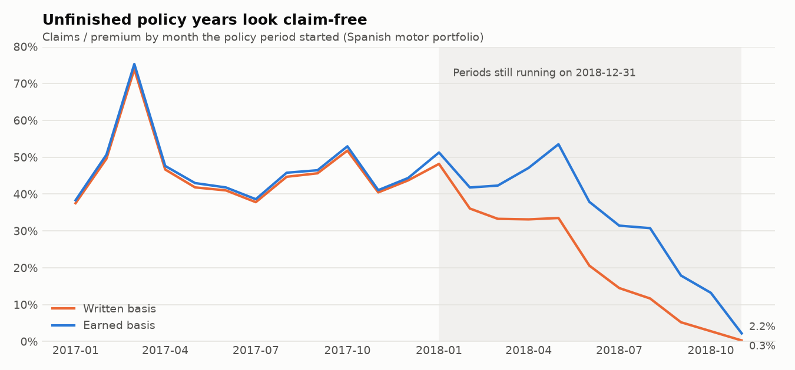
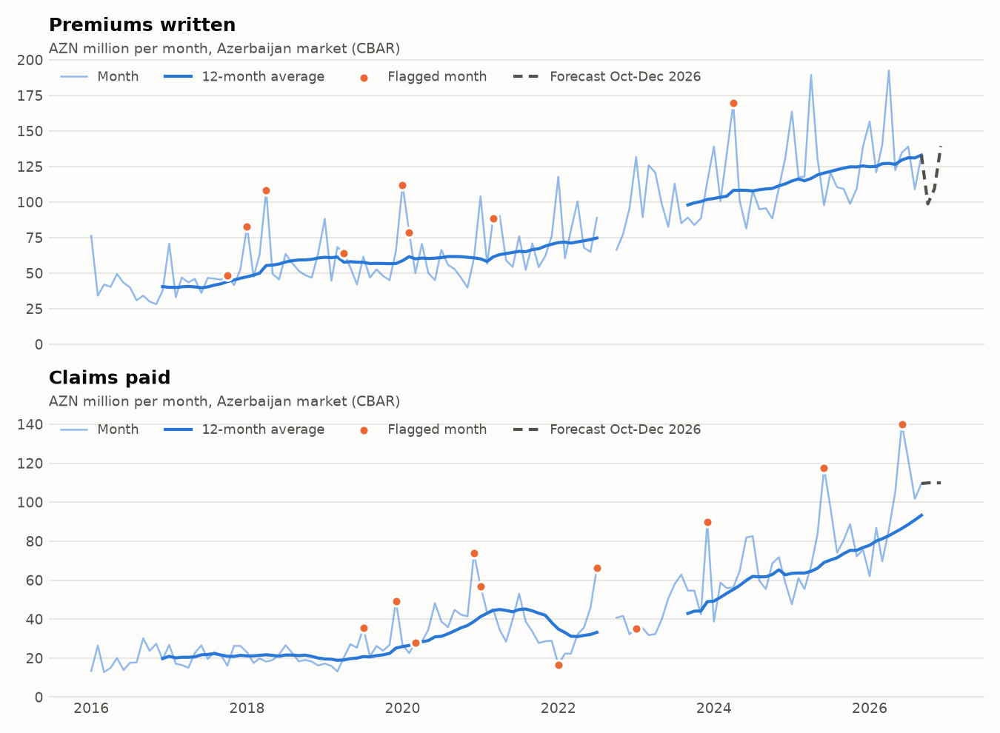
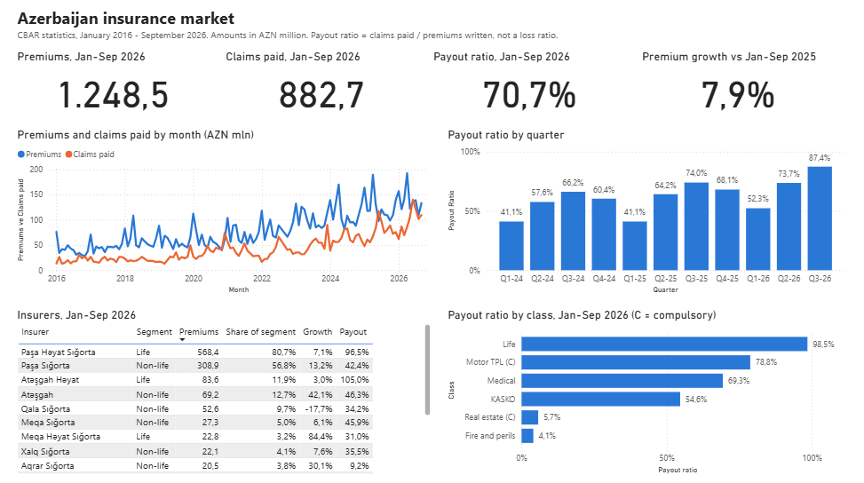
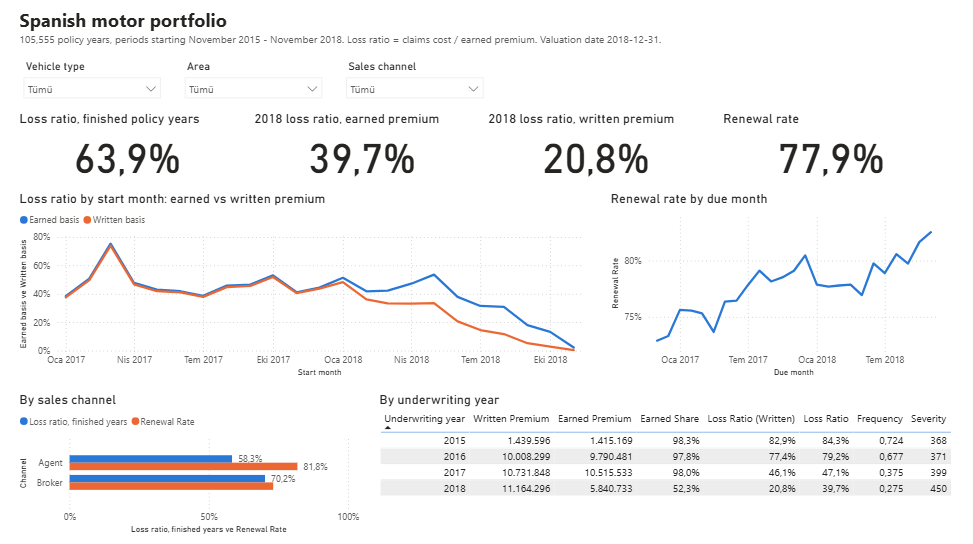
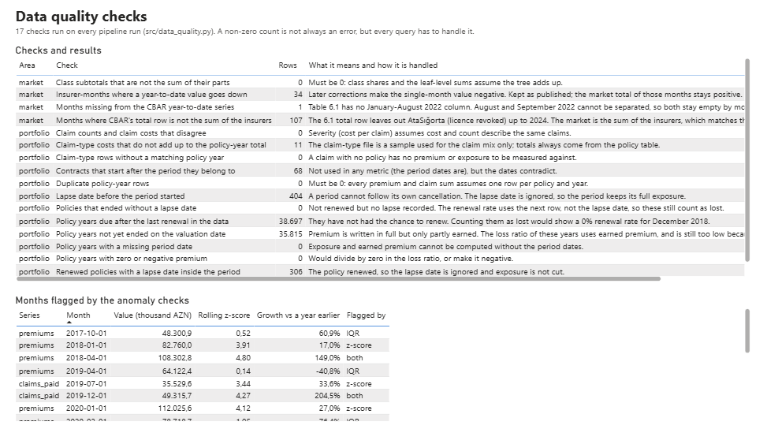

# Insurance Analytics: Azerbaijan Market and a Motor Portfolio

A small, explainable insurance analytics project in two parts:

- **Part A: Azerbaijan market.** Official monthly statistics of the Central Bank of
  Azerbaijan (CBAR), January 2016 to September 2026: premiums, claims paid, payout
  ratio, quarter-over-quarter and year-over-year change, market share per insurer and
  the mix by insurance class, plus simple trend, anomaly and forecast checks.
- **Part B: policy-level data.** A real Spanish motor portfolio (105,555 policy years,
  2015-2018) loaded into SQLite: exposure, earned premium, frequency, severity, loss
  ratio and renewal rate, with data quality checks for every trap found in the data.

The SQL lives in `sql/*.sql`, one CTE per grain. The Power BI report (a Power BI Project
with a TMDL model and DAX measures) is in [`powerbi/`](powerbi/).

---

## Charts

<p align="center">
  
</p>

The written-basis loss ratio falls to 0.3% for policies that started in November 2018.
That is not good business: on 31 December 2018 those policies had been running for one
month. Their premium is all there, but most of their claims have not happened yet.

<p align="center">
  
</p>

The gap in 2022 is real: CBAR did not publish a January-August 2022 column, so August
and September 2022 cannot be separated (the quarter is still exact).

---

## Findings

### Part A: Azerbaijan market, January-September 2026 vs the same months of 2025

| | 9M 2025 | 9M 2026 | Change |
|---|---|---|---|
| Premiums written (AZN mln) | 1,157.3 | 1,248.5 | +7.9% |
| Claims paid (AZN mln) | 683.9 | 882.7 | +29.1% |
| Payout ratio (claims paid / premiums) | 59.1% | 70.7% | +11.6 pp |
| of which life endowment payouts (AZN mln) | 476.3 | 643.4 | +35.1% |
| Non-life payout ratio (voluntary + compulsory) | 39.7% | 42.6% | +2.9 pp |
| Compulsory motor TPL payout ratio | 73.5% | 78.8% | +5.3 pp |
| KASKO payout ratio | 43.1% | 54.6% | +11.5 pp |
| Medical payout ratio | 62.8% | 69.3% | +6.5 pp |
| PAŞA Sığorta premiums (AZN mln) | 272.9 | 308.9 | +13.2% |
| PAŞA Sığorta share of non-life insurers' premiums | 54.4% | 56.8% | +2.4 pp |

1. **Claims grew almost four times faster than premiums, but mostly in life.** Endowment
   (savings) policies paid out 643.4 mln AZN, 73% of all claims paid. Those are
   maturities of savings contracts, not losses. The claims spikes the anomaly check
   flags in June 2025 and June 2026 are endowment payouts (97.1 and 112.7 mln AZN of
   117.4 and 140.0), almost all from one life insurer.
2. **Non-life is getting more expensive too, led by motor.** The KASKO payout ratio rose
   by 11.5 points and compulsory motor TPL is close to 80%.
3. **Q3 2026 had the highest quarterly payout ratio since Q4 2020** (87.4% vs 107.0%).
4. **PAŞA Sığorta keeps gaining share.** It wrote 29.5% of non-life insurers' premiums in
   2016 and 56.8% in 9M 2026.
5. **A widely quoted figure belongs to a different year.** "Premiums 399.1 mln AZN and
   payouts 164 mln AZN in Q1" is Q1 **2025**. Q1 2026 was 417.8 and 218.5.
6. **Simple forecast for Q4 2026:** premiums about 347 mln AZN (same months last year
   won the backtest, average error 9.1%), claims about 330 mln AZN (exponential
   smoothing, average error 15.1%). These are baselines to compare actuals with, not a
   budget.

### Part B: Spanish motor portfolio (amounts in the data's currency)

| Underwriting year | Policy years | Earned share | Loss ratio, written | Loss ratio, earned | Frequency | Severity |
|---|---|---|---|---|---|---|
| 2015 (Nov-Dec) | 4,559 | 98.3% | 82.9% | 84.3% | 0.724 | 368 |
| 2016 | 31,428 | 97.8% | 77.4% | 79.2% | 0.677 | 371 |
| 2017 | 33,753 | 98.0% | 46.1% | 47.1% | 0.375 | 399 |
| 2018 | 35,815 | 52.3% | 20.8% | 39.7% | 0.275 | 450 |

1. **Written premium makes the newest year look twice as good as it is.** On the written
   basis 2018 shows 20.8%, on the earned basis 39.7%. The remaining gap to 2017's 47.1%
   fits claims that happened but are not reported or settled yet (IBNR): they are
   missing from the numerator, and earned premium does not fix that. The data has no
   claim dates, so the gap cannot be measured, only explained.
2. **Broker business is less profitable and less loyal.** On finished periods, broker
   policies have a 70.2% loss ratio against 58.3% for agents (more claims, and more
   expensive ones), and 73.1% of them renew against 81.8%.
3. **Renewal improved every year:** 73.1% of policies due in 2016 renewed, 77.2% in 2017
   and 79.3% in 2018 (77.9% overall). Policies due after the last renewal in the data
   are left out; counting them would show December 2018 as a 0% month.
4. **Open question for the data owner:** the 2015-2016 years have about twice the claim
   frequency of 2017 (0.68 vs 0.37 claims per policy year). The data does not explain
   it, so trend findings compare 2017 with 2018.

---

## Payout ratio is not the loss ratio

CBAR publishes premiums **written** and claims **paid** in a period. Dividing them gives
a payout ratio, which is easy to compute but is not the loss ratio an insurer manages:

```
Payout ratio = claims paid in the period / premiums written in the period

Loss ratio   = incurred claims / earned premium
incurred     = claims paid + change in claim reserves (reported claims + IBNR)
earned       = written premium - change in the unearned premium reserve
```

- **Written vs earned premium.** A one-year policy written on 1 December has earned one
  twelfth of its premium by 31 December. The rest pays for risk that has not run yet.
  A fast-growing insurer writes a lot of unearned premium, so its payout ratio looks low.
- **Paid vs incurred claims.** A claim from March may be paid in September. Paid claims
  miss the claims still open (reported reserves) and the ones not reported yet (IBNR).
- **Life products.** Maturity payments of savings policies count as claims paid, which
  is why the market payout ratio is dominated by life.

Part B shows the written/earned difference on real data. IBNR is described but not
estimated: that needs claim-level development triangles, which neither source has.

---

## Data Quality

Every check is a query in `src/data_quality.py`, runs on every pipeline run, and has a
test with a planted case in `tests/conftest.py`.

| Check | Rows | What it means and how it is handled |
|---|---|---|
| Months missing from the CBAR YTD series | 1 | No January-August 2022 column: August and September 2022 stay empty by month, Q3 2022 is exact |
| CBAR total row is not the sum of the insurers | 107 | Up to 2024 the Table 6.1 total leaves out AtaSığorta (licence revoked): up to 22.4 mln AZN a year. The market is the sum of insurers, which equals the Table 6.2 grand total in 113 of 116 months (the other 3, in 2019, differ by at most 51 thousand AZN) |
| Insurer-months where a YTD value goes down | 34 | Later corrections give negative single months (largest: -9.8 mln AZN claims, 2017). Kept as published |
| Class subtotals that are not the sum of their parts | 0 | The class tree adds up, so shares can use leaf lines safely |
| Duplicate policy-year rows | 0 | One row per policy and year |
| Claim-type rows without a matching policy year | 0 | |
| Policy years with zero or negative premium | 0 | |
| Policy years with a missing period date | 0 | |
| Contracts that start after the period they belong to | 68 | Contradicting dates; the period dates are used |
| Lapse date before the period started | 404 | Lapse ignored, full exposure kept |
| Renewed policies with a lapse date inside the period | 306 | Lapse ignored, the next row proves the renewal |
| Policies that ended without a lapse date | 0 | The 2,298 candidates were all due in December 2018, after the data ends |
| Policy years not yet ended on the valuation date | 35,815 | Premium written but only partly earned: earned basis used |
| Policy years due after the last renewal in the data | 38,697 | Not counted as renewed or lost |
| Claim counts and claim costs that disagree | 0 | |
| Claim-type costs that do not add up to the total | 11 | Claim-type file used for the mix only |
| Vehicles with power recorded as 0 | 1,764 | Means unknown; not used in the KPIs |

Run the checks from the project root:

```bash
python -m src.data_quality
```

### Metric definitions

| Metric | Definition |
|---|---|
| Premiums, claims paid (market) | CBAR figures in thousand AZN. Published year-to-date; a month is its YTD minus the previous month's YTD, a quarter its YTD minus the YTD three months earlier |
| Market | Sum of all insurers in Table 6.1, including insurers whose licence was later revoked |
| Payout ratio | Claims paid / premiums written in the same period |
| Market share | Insurer premiums / market premiums in the quarter. Segment share: / premiums of all life (or all non-life) insurers |
| QoQ, YoY | Value / value of the previous quarter (QoQ) or the same quarter a year earlier (YoY) - 1 |
| Policy year | One row of the portfolio: one policy, one annual period from `Date_last_renewal` to `Date_next_renewal` |
| Valuation date | 2018-12-31, the end of the data |
| Exposure | Share of the policy year on risk until the valuation date, the next renewal, or the lapse date of a policy cancelled during its last period |
| Written premium | `Premium` of the policy year |
| Earned premium | Written premium x exposure (pro rata) |
| Frequency | Claims / exposure years |
| Severity | Claims cost / claims |
| Loss ratio (written, earned) | Claims cost / written premium, or / earned premium |
| Loss ratio, finished years | Earned-basis loss ratio of policy years that ended by the valuation date (started up to December 2017); used to compare segments |
| Renewal rate | Policy years renewed / policy years due. Due = the period ended on or before the last renewal date in the data (2018-11-30); renewed = the same policy has a next period |

---

## Trend, anomaly and forecast in plain words

`src/trends.py` runs on the monthly market series.

- **Moving average:** the average of the last 3 or 12 months, to see the direction
  without the month-to-month noise.
- **Rolling z-score:** how far a month is from the 12 months before it, in standard
  deviations. Beyond 3 it is flagged. It uses only past months, so a spike cannot hide
  by pulling up its own average. Its weak spot is seasonality: January premiums are
  usually high, and the z-score of every January from 2017 is between 1.1 and 4.1
  (2018 and 2020 are flagged).
- **IQR rule on year-over-year growth:** each month is compared with the same month a
  year earlier, which removes the seasonal pattern. Growth rates far outside the middle
  half of all growth rates (beyond 1.5 times the interquartile range) are flagged.
- **Forecasts:** three simple methods, each tested by pretending to stand at the end of
  each of the last 12 months and predicting the next one:
  - moving average: next month = average of the last 3;
  - exponential smoothing: a running average that gives recent months more weight
    (the weight is picked by the smallest past error);
  - seasonal naive: next October = last October.

  The method with the smallest average error is used. Seasonal naive wins for premiums
  (they follow the calendar), exponential smoothing for claims (they follow the trend).

Outputs: `data/processed/market_anomalies.csv`, `market_forecast.csv`,
`market_forecast_backtest.csv`.

---

## Power BI

[`powerbi/insurance_analytics.pbip`](powerbi/insurance_analytics.pbip) is the report as
a Power BI Project: the model in TMDL (11 tables, 32 measures, 11 relationships) and
three report pages in PBIR, all plain text. Open it in Power BI Desktop, press
**Refresh** once (a PBIP does not store data), then save.

<p align="center">
  
</p>

<p align="center">
  
</p>

<p align="center">
  
</p>

Design choices worth knowing:

- Only sums are stored in the fact tables; every ratio is a DAX measure that divides
  two sums, so it stays right under any filter.
- The `Date` table ends on the last month CBAR has published. Otherwise
  `SAMEPERIODLASTYEAR` would compare 9 months of 2026 with 12 months of 2025.
- `Loss Ratio (Finished)` compares segments on policy years that ended by the
  valuation date, for the same reason as the written/earned chart above.
- The base measures are `Total Premiums` and `Total Claims Paid`: Power BI compares
  names without case, so a measure called `Premiums` clashes with the column `premiums`.

The model was parsed with Power BI's own TMDL serializer, the report files were
validated against Microsoft's published JSON schemas, and the project was opened and
refreshed in Power BI Desktop, where the measures returned the figures in this README.
[`powerbi/POWERBI_GUIDE.md`](powerbi/POWERBI_GUIDE.md) explains how to open it and how
to build the same report by hand, and
[`powerbi/DAX_measures.md`](powerbi/DAX_measures.md) lists every measure.

---

## Project Structure

```
insurance-analytics/
├── data/
│   ├── raw/cbar/               # CBAR Tables 6.1 and 6.2 (xlsx)
│   ├── raw/portfolio/          # Lledó & Pavía motor portfolio (csv, downloaded)
│   ├── processed/              # CSV outputs, the Power BI inputs
│   └── insurance.db            # SQLite database (built by the pipeline)
├── docs/
│   ├── images/                 # README charts and Power BI screenshots
│   └── summary_az.md           # One-page summary in Azerbaijani
├── powerbi/
│   ├── insurance_analytics.pbip            # Power BI Project: open this
│   ├── insurance_analytics.SemanticModel/  # Model in TMDL: tables, measures, Power Query
│   ├── insurance_analytics.Report/         # Report pages in PBIR
│   ├── POWERBI_GUIDE.md                    # How to open it, or build it by hand
│   └── DAX_measures.md                     # Every DAX measure
├── sql/
│   ├── policy_year.sql         # View: exposure, earned premium, renewal per policy year
│   ├── kpi_by_uw_year.sql      # Written vs earned loss ratio by underwriting year
│   ├── portfolio_monthly.sql   # Monthly KPIs and renewal rate
│   ├── kpi_by_segment.sql      # Vehicle type, area, channel
│   ├── fact_portfolio.sql      # Power BI fact tables
│   ├── fact_renewal.sql
│   ├── market_monthly.sql      # Market by month
│   ├── market_quarterly.sql    # Market by quarter, QoQ and YoY (window functions)
│   ├── insurer_quarterly.sql   # Market share per insurer
│   └── class_quarterly.sql     # Main insurance classes
├── src/
│   ├── cbar_loader.py          # CBAR wide YTD sheets -> tidy months and quarters
│   ├── database.py             # Loads everything into SQLite, runs sql/ files
│   ├── data_quality.py         # Data quality checks
│   ├── trends.py               # Moving average, z-score, IQR, forecasts, backtest
│   ├── charts.py               # README charts
│   └── download.py             # Fetches the raw files
├── tests/                      # 33 pytest tests on sample files with planted traps
├── run_pipeline.py             # Builds the database, checks, tables and charts
└── requirements.txt
```

---

## Getting Started

```bash
python -m venv venv
venv\Scripts\activate          # Windows
# source venv/bin/activate     # macOS / Linux

pip install -r requirements.txt
python -m src.download         # raw files into data/raw/
python run_pipeline.py         # database, checks, data/processed/*.csv, charts
```

Then open `powerbi/insurance_analytics.pbip` in Power BI Desktop. The `DataFolder`
parameter holds the full path of `data/processed`: set it to the folder of your copy
(**Transform data > Edit parameters**), then press **Refresh**.

### Running Tests

```bash
python -m pytest tests/ -v
```

Expected output: 33 tests passing. The tests build their own small sample files with
the same layout and the same traps as the real data, so they do not need the downloads.

---

## Data Sources

| Source | Content | Licence |
|---|---|---|
| [Central Bank of Azerbaijan, insurance statistics](https://www.cbar.az/page-189/insurance), Tables 6.1 and 6.2 | Premiums written and claims paid by insurer (from 2016) and by class (from 2017), monthly year-to-date, "operational data" | Official public statistics, cited as the source |
| Lledó, J. & Pavía, J. M. (2024). *Dataset of an actual motor vehicle insurance portfolio*. Mendeley Data, V2. [doi:10.17632/5cxyb5fp4f.2](https://doi.org/10.17632/5cxyb5fp4f.2) | 105,555 policy years of a Spanish non-life motor portfolio, November 2015 - December 2018 | CC BY 4.0 |

---

## Tech Stack

| Layer | Technology |
|---|---|
| Language | Python 3.10+ |
| Data | pandas, NumPy, openpyxl |
| Database | SQLite (CTEs, window functions) |
| Charts | Matplotlib (README charts) |
| Report | Power BI Desktop: PBIP with a TMDL model, PBIR pages, DAX measures, Power Query |
| Testing | pytest |

---

## License

Code: for educational and portfolio purposes. Data: see the licences above.
